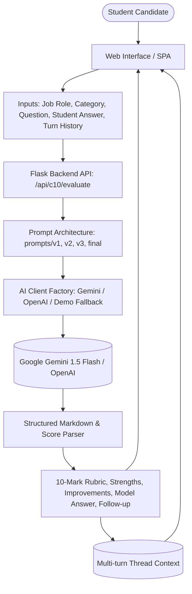

# 🚀 AI-Powered Software Engineering Mock Interview Coach
### Problem C10: Mock Interview Question and Feedback Tool
**Bennett University — B.Tech CSE (SCSE4041 Prompt Engineering Mini Project)**

[](https://huggingface.co/spaces/Shauriya24/AI-Powered-Interview-Coach)
[](https://github.com/sagar-goyal162005/AI-powered-Interview-Coach)

> 🌐 **Live Hugging Face Space:** [https://huggingface.co/spaces/Shauriya24/AI-Powered-Interview-Coach](https://huggingface.co/spaces/Shauriya24/AI-Powered-Interview-Coach)

---

## 📖 About
**AI-Powered Software Engineering Mock Interview Coach** is an applied artificial intelligence system designed for computer science students preparing for technical software engineering placement interviews. Developed under **SCSE4041 Prompt Engineering** at Bennett University for **Problem C10: Mock Interview Question and Feedback Tool**, the system delivers instant, rubric-grounded assessment and adaptive follow-up questioning across DSA, Core Computer Science (DBMS, OS, OOP, CN), and Software Projects.

Combining **multi-stage prompt engineering**, **rubric-based evaluation**, **adaptive multi-turn follow-up questioning**, **speech analysis**, **video posture detection**, and **ATS resume scanning**, the platform provides an end-to-end placement preparation suite available both as a **[Live Hugging Face Space](https://huggingface.co/spaces/Shauriya24/AI-Powered-Interview-Coach)** and as a locally deployable Flask application.

---

## 👥 Team CodeSync
- **Sagar Goyal** (S24CSEU0441)
- **Shauriya Garg** (S24CSEU0409)
- **Sarthak Maheswari** (S24CSEU0472)
- **Rohit Mukhopadhyay** (S24CSEU0375)

---

## 📌 Problem Statement (C10)
College students preparing for technical placements often lack access to realistic, technical mock interviews with instant, actionable feedback. Generic interview tools only provide vague text suggestions without structured scoring, domain-specific depth, or context-aware follow-up questions.

This project addresses Problem C10 by providing an intelligent mock interview coach covering:
1. **Data Structures and Algorithms (DSA)**
2. **Core Computer Science:**
   - Database Management Systems (DBMS)
   - Object-Oriented Programming (OOP)
   - Operating Systems (OS)
   - Computer Networks (CN)
3. **Software Development Project-based Questions**

---

## ✨ Key Features
- **Prompt Engineering Evaluation Engine:**
  - Evaluates student answers across a standardized 10-mark rubric:
    - **Technical Accuracy:** 0–4 marks
    - **Completeness:** 0–2 marks
    - **Relevance:** 0–2 marks
    - **Communication & Clarity:** 0–2 marks
  - Provides categorized strengths, targeted areas for improvement, an improved model answer, and a follow-up question.
- **Selectable Prompt Versions (Academic Comparison):**
  - **Version 1 (V1):** Baseline role prompting with open feedback.
  - **Version 2 (V2):** 10-mark rubric with table formatting.
  - **Version 3 (V3):** Refined scoring anchors (4/3/2/1/0, 2/1/0) and evidence verification.
  - **Final Prompt:** Multi-turn context injection and edge-case guardrails (empty, Hinglish, off-topic).
- **Multi-Turn Interview Workflow:** Maintains conversation history (`thread_turns`) so adaptive follow-up questions drill deeper into the candidate's prior responses.
- **Full-Stack Practice Modes:**
  - Text input practice.
  - Audio speech recording (in-browser SpeechRecognition).
  - Video practice with real-time OpenCV posture detection.
- **ATS Resume Scanner:** Scans `.pdf`, `.docx`, and `.txt` resumes against software engineering job descriptions.
- **Reinforcement Learning Coach:** OpenEnv-compatible RL environment exploring feedback strategies.
- **Progress Tracking & PDF Reports:** Comprehensive performance history exportable to PDF.

---

## 🏗️ System Architecture & Workflow



---

## 📂 Repository Organization

```text
AI-Interview-Coach/
│
├── README.md                          # Project documentation and setup guide
├── CHANGELOG.md                       # Dated change log since Milestone 1
├── openenv.yaml                       # OpenEnv environment specification
├── requirements.txt                   # Project dependencies
├── app.py                             # Core Flask application
├── c10_evaluator.py                   # C10 evaluation module and SWE question bank
├── ats_checker.py                     # ATS resume parser and analyzer
│
├── prompts/                           # Decoupled prompt engineering assets
│   ├── prompt_loader.py               # Dynamic template formatter
│   ├── v1/
│   │   ├── evaluator_v1.txt           # Version 1 baseline prompt
│   │   └── response_v1.md             # Verified ChatGPT response for TC01 (8/10)
│   ├── v2/
│   │   ├── evaluator_v2.txt           # Version 2 rubric prompt
│   │   └── response_v2.md             # Verified ChatGPT response for TC01 (8.5/10)
│   ├── v3/
│   │   ├── evaluator_v3.txt           # Version 3 refined anchor prompt
│   │   └── response_v3.md             # Verified ChatGPT response for TC01 (9/10)
│   └── final/
│       └── evaluator_final.txt        # Final production prompt with context & guardrails
│
├── test-data/
│   └── test_dataset.json              # 10 standardized technical test cases + edge cases
│
├── experiment-results/
│   └── experiment_log.md              # Experimental benchmark logs and comparisons
│
├── docs/                              # Academic documentation
│   ├── Prompt_Engineering_Experiment_Documentation.docx
│   └── AI_Software_Interview_Coach_Final_Report.docx
│
├── presentation/                      # Final viva presentation
│   └── AI_Software_Interview_Coach_Final_Presentation.pptx
│
├── templates/
│   └── index.html                     # Frontend Single Page Application
├── static/
│   ├── app.js                         # Dynamic frontend logic & API communication
│   ├── styles.css                     # Modern student-friendly UI styling
│   └── logo.png                       # Application branding
│
└── test_integration.py                # End-to-end integration test suite
```

---

## 🧪 Experimental Benchmarks (TC01 Verified Run)

**Question:** *What is the difference between an Array and a Linked List?*  
**Candidate Answer:** *"An array stores elements in continuous memory locations, while a linked list stores elements in nodes connected using pointers. Arrays allow faster access using indexes, whereas linked lists make insertion and deletion easier in certain situations."*

| Metric | Version 1 (V1) | Version 2 (V2) | Version 3 (V3) | Final Prompt |
| :--- | :---: | :---: | :---: | :---: |
| **Prompt Style** | Role Prompting | 10-Mark Rubric | Refined Scoring Anchors | Multi-Turn + Guardrails |
| **Total Score** | **8.0 / 10** | **8.5 / 10** | **9.0 / 10** | **9.0 / 10** |
| **Technical Accuracy** | 9 / 10 (unweighted) | 4.0 / 4 | 4.0 / 4 | 4.0 / 4 |
| **Completeness** | 7 / 10 (unweighted) | 1.5 / 2 | 1.0 / 2 | 1.0 / 2 |
| **Relevance** | Unscored | 2.0 / 2 | 2.0 / 2 | 2.0 / 2 |
| **Clarity & Communication** | 8 / 10 (unweighted) | 1.0 / 2 | 2.0 / 2 | 2.0 / 2 |
| **Edge-Case Guardrails** | None | None | Basic | Strict (handles empty, idk, Hinglish) |
| **Status** | **VERIFIED** | **VERIFIED** | **VERIFIED** | **VERIFIED** |

*Note: In compliance with academic integrity guidelines, only TC01 has been experimentally verified on ChatGPT. Test cases TC02 through TC10 remain marked as PENDING.*

---

## ⚙️ Installation & Local Setup

### 1. Prerequisites
- Python 3.10+ (tested on Python 3.12)
- Git

### 2. Clone the Repository
```bash
git clone https://github.com/sagar-goyal162005/AI-powered-Interview-Coach.git
cd AI-powered-Interview-Coach
```

### 3. Virtual Environment Setup
```bash
# Windows (PowerShell)
python -m venv .venv
.\.venv\Scripts\Activate.ps1
python -m pip install -r requirements.txt

# Linux / macOS
python3 -m venv .venv
source .venv/bin/activate
pip install -r requirements.txt
```

### 4. Environment Variables Configuration
Copy `.env_example` to `.env`:
```bash
cp .env_example .env
```
Open `.env` and set your preferred AI provider:

```env
# AI Provider Configuration (Google Gemini via OpenAI-Compatible API - Preferred)
API_KEY=your_gemini_api_key_here
API_BASE_URL=https://generativelanguage.googleapis.com/v1beta/openai/
MODEL_NAME=gemini-1.5-flash

# Alternative AI Provider Configuration (OpenAI)
# API_KEY=your_openai_api_key_here
# API_BASE_URL=https://api.openai.com/v1
# MODEL_NAME=gpt-4o-mini
```
*Note: If no API key is provided, the application automatically enters **Offline Simulation Demo Mode** so that all evaluation features can be tested and demonstrated without breaking.*

---

## 🚀 Running the Application

### Start the Flask Server
```bash
python app.py
```
Open your browser and navigate to:
```
http://127.0.0.1:7860
```

### Run Automated Tests
```bash
# Run C10 module unit tests
python test_c10.py

# Run backend endpoint tests
python test_endpoints.py

# Run full end-to-end integration tests
python test_integration.py
```

---

## 📄 Documentation Deliverables
The complete academic documentation for Bennett University submission is located in `docs/` and `presentation/`:
- `docs/Prompt_Engineering_Experiment_Documentation.docx`: Full prompt engineering experiment report with complete prompt texts, actual ChatGPT responses, and comparative tables.
- `docs/AI_Software_Interview_Coach_Final_Report.docx`: Comprehensive final project report adhering to the prescribed 12-chapter university structure.
- `presentation/AI_Software_Interview_Coach_Final_Presentation.pptx`: 12–15 slide presentation deck for project viva and faculty evaluation.

---

## 📜 License
This project is open-source under the MIT License.
